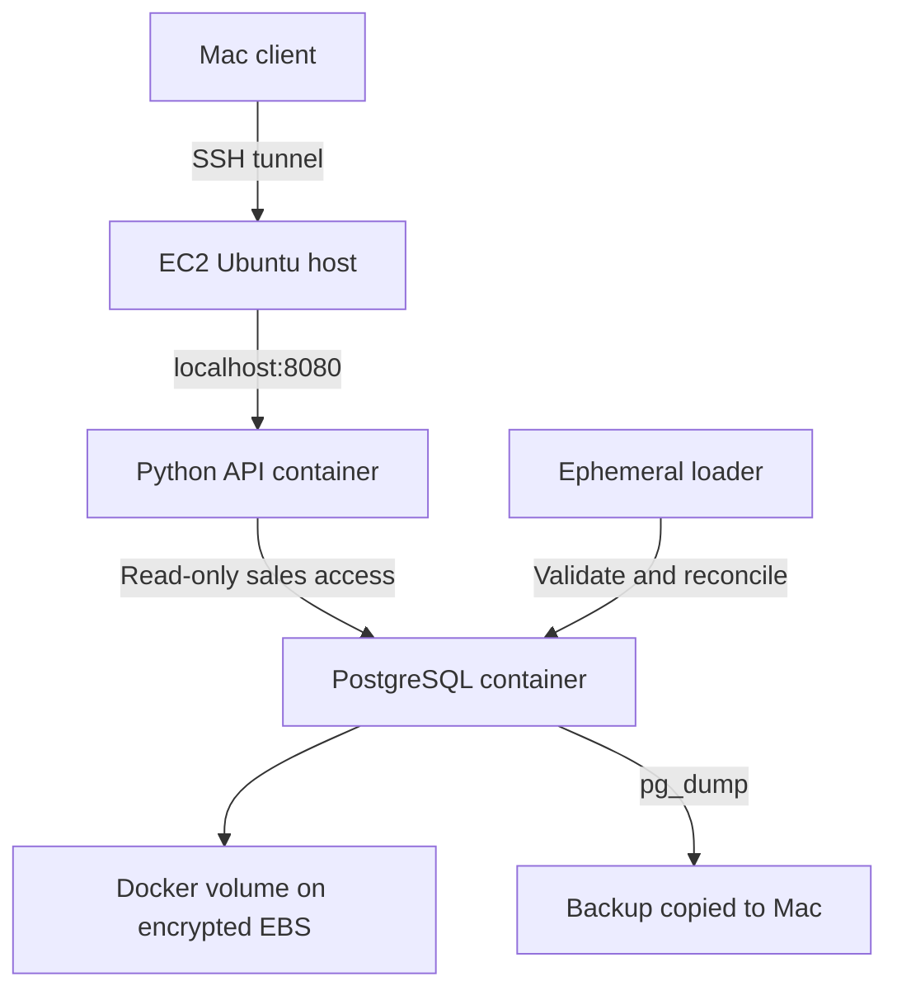

# FMCG Cloud Foundation — AWS Portfolio Case Study

Status: AWS EC2 demo verified through author-provided terminal evidence, 13 October 2026. Mac Docker monitoring/outage trial passed on 19 October; existing-stack preflight passed on 20 October. These new trials are not EC2 monitoring evidence. All business data are 100% synthetic. This is a personal portfolio lab, not production or customer consulting.

## Operations case study

[Read the operations case study](docs/OPERATIONS_CASE_STUDY.md): stack identification → health monitoring → database outage investigation → restart and auth/data validation. Includes exact environment boundaries, CI evidence and a short project walkthrough.

- Mac outage observation: live 200 / ready 503 / anonymous summary 401; local watch then alert. A separate recovery probe and auth/data checks passed.
- Mac preflight: all 16 checks passed against the existing Compose project and named database volume.
- [Acceptance run 39356902071](https://github.com/Quetzel6/fmcg-cloud-foundation/actions/runs/39356902071): 26 tests plus Docker integration for code commit `2fb7c90bf1a409e83a173d795931a0a162b8dd50`. Later documentation-only commits have their own workflow status.

## Reproducible data recovery drill

[Recovery runbook and evidence](docs/RECOVERY_DRILL.md) adds a disposable Docker drill for sales-table loss: backup, failed restart-only recovery, transactional restore, table-content reconciliation and restored API permissions. The new trial is local, not AWS; remote CI execution of this addition is not yet verified. Historical AWS and Mac evidence below retains its original scope. During this scenario, readiness stays **200** while authenticated data returns **503**; restoring data without ACLs requires reapplying the API grants before reporting recovers.

## Requirement and implementation
A hypothetical analytics team needs a reproducible sales snapshot, authenticated read-only reporting, operational health checks and recoverable storage. The implementation uses Python, PostgreSQL 16 and Docker Compose on one Ubuntu 24.04 EC2 t3.small in Singapore. A single server was chosen to keep the demonstration simple; API and database share a failure domain and have no high availability.

The API is bound to 127.0.0.1:8080. PostgreSQL has no host-published port. Remote testing uses an SSH tunnel bound to Mac localhost:18080, not a public HTTP endpoint. Protected data endpoints require a shared Bearer token. Container hardening includes a nonroot API, read-only filesystem, dropped capabilities and no-new-privileges. Secrets are generated on the EC2 host and held in a permission-restricted .env; no cloud secret manager or rotation has been implemented.

## Security configuration evidence
Launch screenshots showed Ubuntu 24.04, t3.small, one instance and 20 GiB encrypted gp3 storage; the running-instance screenshot showed IMDSv2 Required. SSH My IP, CPU credits Standard and disabled detailed monitoring were reported configured by the author, not independently audited. A separate IAM deployment identity has not been verified. Do not describe root-account usage as a completed IAM best-practice implementation.

## Verified results
| Test | Evidence and scope |
|---|---|
| AWS health | live 200, ready 200, missing route 404; API and PostgreSQL Healthy |
| AWS data | 150600 sales rows, quantity 1931506, amount_satang 11929529809, 2024-01-01 through 2026-09-30 |
| AWS auth | missing/wrong token 401, valid token 200; author reported initial checks passed and later provided all six successful outputs |
| Database access | fmcg_api sales SELECT passed; UPDATE, DELETE, INSERT, truth access, schema/temp creation and admin role denied; explicit output after recovery |
| Mac tunnel | alive, ready and unauthenticated summary HTTP 401 |
| Restore | fresh database restored; sales count, quantity, amount and date bounds matched source |
| Off-host backup | four files copied to Mac; dump SHA-256 matched on both hosts |
| Service recovery | author reported EC2 stop/start; manual Compose startup succeeded, data/auth/access checks passed |
| Local unit tests | 14 passed earlier on Mac; not claimed rerun on EC2 |

Backup: fmcg_20261013_025851.dump. SHA-256: bfafdb4feb78d61814b33727bf1020e1a3b4a0f613cb1283e8c623bef33f159e.

The first source comparison file was empty; a successful source query regenerated it before the final matching comparison. Restore verification covers sales aggregates, not every row or table. The dump omits ownership and ACLs; it does not restore roles or prove restored API permissions. Access probes were run against the active original database. No RTO/RPO was measured.

## Limits and next improvements
No public HTTPS endpoint, high availability, performance benchmark, automatic restart policy, centralized monitoring/alerts, infrastructure as code is claimed; GitHub Actions verification is recorded below. The standalone server allows local unauthenticated operation if its token environment is absent; Compose requires a token. The loader uses an elevated lab owner role. No measured business uplift or real customer data was used.

Azure resource creation was blocked by a subscription restriction; this deployment was completed on AWS. Stop compute when idle, retain EBS for data, and review Billing. Budget alerts are not a spending cap.

## GitHub Actions and project links

[Cloud acceptance run](https://github.com/Quetzel6/fmcg-cloud-foundation/actions/runs/38371740483) passed on 13 October 2026 for commit `fac09ce4d129fdbef527c200e4189656da4c3cb4`. It runs unit tests, a disposable Docker/PostgreSQL stack, repeated synthetic ingestion, API/database access checks and database outage recovery. This CI run tests a GitHub runner, not the deployed EC2 host.

- [Analytics platform](https://github.com/Quetzel6/fmcg-analytics-platform): generation, validation, analytics and offline dashboards.
- [AWS operations guide](docs/AWS_RUNBOOK.md)
- [Architecture and operational evidence](docs/OPERATIONS_CASE_STUDY.md)
- [Local setup from a fresh checkout](docs/LOCAL_SETUP.md)

## Repository use
Clone this repository and follow the local setup or AWS operations guide. Keep the application source, .env and retained database volumes intact. Do not publish private keys, tokens, personal account details or raw portal screenshots.
